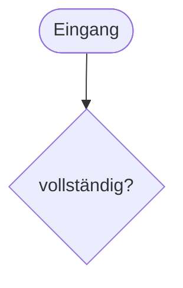

# chart — Drawing Specification

`chart` is a drawing surface whose document **is** a diagram. You sketch a box, type
into it, pull an arrow to the next box, and the tool writes Mermaid. Shape recognition
is geometric, not learned. Label text is **typed**, never handwritten.

Written entirely in AIML. Mermaid emission reuses the proven id/label hygiene of
`aidoc` (`test/aidoc/src/charts.aiml`).

---

## 1. Goal

One surface, three jobs:

1. **Draw** — freehand strokes become clean primitives (rect, rounded, diamond,
   circle, hexagon, arrow) the moment the stroke ends (§7).
2. **Label** — click a shape, type into it. A real editable field, not a guess (§6).
3. **Export** — the sheet projects to Mermaid, continuously previewed and writable
   to a `.mmd` file (§5).

### 1.1 Non-goals (v1, normative)

| Not in v1 | Why / what instead |
|---|---|
| Handwriting recognition | Labels are typed (§6). The feature is not deferred for cost reasons alone — a typed label is *exactly* right, a recognised one is 90% right, and a diagram with a wrong word in it is worse than no diagram. |
| Mermaid **import** | Export is one-way (§2). A best-effort importer may come later; it can never be the document path. |
| Diagram types beyond `flowchart` | `Sheet.dtype` (§3.1) exists so `sequence`/`state`/`class` can be added without a format break. Only `flowchart` is emitted. |
| Auto-layout | Positions belong to the user. Mermaid re-lays out on render, and that is accepted (§5.7). |

---

## 2. The sheet is canonical; Mermaid is a projection

**Normative.** The editable document is a `*.chart.yaml` sheet (§4). Mermaid is
produced *from* the sheet and is **lossy**. Therefore:

- Every edit changes the **sheet**. Nothing ever edits the Mermaid text.
- Export is a **pure function** of the sheet: same sheet in, same bytes out.
- The tool **never** reads its own Mermaid output back as the source of truth.

The reason this rule is first, and not an implementation note: as soon as colour,
grouping and geometry became element properties (§3), Mermaid stopped being able to
hold the whole document. `style`/`classDef` carry colour; nothing carries coordinates,
sizes or anchor sides. A tool that treated its Mermaid as its document would lose the
drawing on every reopen — silently, and only for the user who had arranged it
carefully.

---

## 3. Document model

### 3.1 Models

```aiml
- model:
    name: Sheet
    description: "One slide: a drawing, and the canonical document for it (spec §2)"
    fields:
      - [dtype, DiagramType, flowchart]   # only `flowchart` emits in v1
      - [dir, Direction, TD]
      - [title, string, ""]            # slide heading; the `# ` of the Markdown export (§13)
      - [notes, string, ""]            # speaker notes: presenter only, never on the slide (§14)
      - [nodes, list<Node>]
      - [edges, list<Edge>]
      - [groups, list<Group>]
      - [next_id, i32, 1]              # monotonic; never reused, so ids stay stable (§5.1)

- model:
    name: Node
    fields:
      - [ident, string, ""]            # "n7"; stable for the sheet's lifetime
      - [kind, NodeKind, NodeKind.rect]
      - [pos_x, f32, 0.0]              # design coords, top-left anchor
      - [pos_y, f32, 0.0]
      - [width, f32, 120.0]
      - [height, f32, 60.0]
      - [text, string, ""]             # may contain "\n"; the caption of an image (§12)
      - [src, string, ""]              # image file, relative to the deck (§12); "" for every other kind
      - [fill, i32, 0]                 # 0xRRGGBBAA; 0 = inherit theme (§5.6)
      - [stroke, i32, 0]
      - [group, string, ""]            # owning Group.ident, "" = top level

- model:
    name: Edge
    fields:
      - [ident, string, ""]
      - [from_id, string, ""]          # Node.id
      - [to_id, string, ""]
      - [kind, EdgeKind, arrow]
      - [text, string, ""]             # edge label, "" = none
      - [stroke, i32, 0]

- model:
    name: Group
    fields:
      - [ident, string, ""]
      - [title, string, ""]
      - [parent, string, ""]           # nesting; "" = top level

**Field names, not YAML keys.** A model field must be at least three characters
(aiml spec/49 §23), hence `ident`/`pos_x`/`width`/`height`. The YAML keys stay short —
`id`, `x`, `y`, `w`, `h` (§4) — because a sheet is hand-edited and the check is on the
model, not on the file. Only the (de)serialiser knows both spellings.
```

### 3.2 Vocabularies

These words cross a file boundary (§4) — the sheet on disk names them and a later
build reads them back. They are therefore `wire: true` (spec/49 §18.2a): the members
*are* the contract, so an unused one must not warn.

```aiml
- enum:
    name: NodeKind
    wire: true
    values: [rect, round, stadium, circle, diamond, hexagon, cylinder, subroutine, image]

- enum:
    name: EdgeKind
    wire: true
    values: [arrow, open, dotted, thick, bidirectional, invisible]

- enum:
    name: DiagramType
    wire: true
    values: [flowchart, sequence, state, class]

- enum:
    name: Direction
    wire: true
    values: [TD, LR, BT, RL]
```

**Normative.** The model fields carry the **enum type**, not a string (§3.1). Only the
YAML (de)serialiser converts, and only there may a member name appear as text. Note that
`enums.value` takes a *literal* member (aiml spec/14), so string-to-enum is an explicit
mapping in the loader, not reflection — and an unknown word is therefore reported rather
than silently mapped to member 0. `static_off` is not to be used to silence a finding about them
(see memory: static checks are findings, not formalities).

---

## 4. Native format

A sheet is YAML, read with `yaml.parse_file` and written by hand — the same stack
`aidoc` uses, no extra runtime.

```yaml
dtype: flowchart
dir: TD
next_id: 5
groups:
  - { id: g1, title: "Auth", parent: "" }
nodes:
  - { id: n1, kind: stadium, x: 40,  y: 40,  w: 140, h: 56, text: "Start" }
  - { id: n2, kind: diamond, x: 40,  y: 160, w: 160, h: 90, text: "valid?", group: g1, fill: 0x2E4A7AFF }
  - { id: n3, kind: rect,    x: 260, y: 170, w: 140, h: 60, text: "Session\nanlegen" }
edges:
  - { id: e1, from_id: n1, to_id: n2, kind: arrow }
  - { id: e2, from_id: n2, to_id: n3, kind: arrow, text: "ja" }
```

**Normative.** An unknown `kind` on load is **not** silently defaulted: the loader
reports the file, the element id and the unknown word, and loads the sheet with that
element marked invalid. A sheet that lost a shape without saying so would be the same
class of failure as §2.

---

## 5. Mermaid projection

### 5.1 Ids

`Node.id` is already identifier-safe (`n` + integer) and emitted verbatim. Ids come
from `Sheet.next_id` and are **never reused** after a delete, so a diff between two
exports stays readable.

### 5.2 Node shapes

| `NodeKind` | Mermaid |
|---|---|
| `rect` | `n1["text"]` |
| `round` | `n1("text")` |
| `stadium` | `n1(["text"])` |
| `circle` | `n1(("text"))` |
| `diamond` | `n1{"text"}` |
| `hexagon` | `n1{{"text"}}` |
| `cylinder` | `n1[("text")]` |
| `subroutine` | `n1[["text"]]` |

Labels are always quoted and escaped: `"` → `#quot;`, newline → `<br/>`. Quoting
unconditionally avoids the whole class of bugs where a label containing `(`, `[` or
`-` reshapes the node.

### 5.3 Edges

| `EdgeKind` | without label | with label |
|---|---|---|
| `arrow` | `-->` | `-->\|"text"\|` |
| `open` | `---` | `---\|"text"\|` |
| `dotted` | `-.->` | `-.->\|"text"\|` |
| `thick` | `==>` | `==>\|"text"\|` |
| `bidirectional` | `<-->` | `<-->\|"text"\|` |
| `invisible` | `~~~` | (label dropped) |

On the canvas an edge kind is **visible**: `dotted` draws as dashes, `thick` with a
heavier line, `invisible` is not drawn at all (it still orders the Mermaid layout). An
editor where every arrow looks the same would make the author read the file to see what
they drew.

The pipe form carries the label, not the `-- text -->` form, so that **one** quoting rule
covers every label in the file (§5.2). With the inline form a label containing `-` or `>`
reshapes the arrow itself, and the failure is a changed diagram rather than an error.

### 5.4 Direction

`flowchart ${dir}` on the first line. The editor can **propose** a direction from the
layout (dominant arrow axis: more |dy| than |dx| over all edges → `TD`, else `LR`), but
the proposal only ever writes `Sheet.dir` through an explicit user action (§8) — never
on export, because an export that changes the document violates §2.

### 5.5 Groups

Each `Group` becomes a `subgraph`, nested per `Group.parent`:

```
subgraph g1 ["Auth"]
  n2
end
```

A node is emitted **inside** its group's block and nowhere else. Edges are always
emitted after all groups, at top level — Mermaid resolves them by id, and keeping them
out of the blocks avoids accidentally pulling an endpoint into a subgraph.

### 5.5a Output order (normative)

Export is promised to be a pure function of the sheet (§2), so the order is fixed, not
incidental:

1. `flowchart <dir>`
2. `classDef` lines, by class index
3. `subgraph` blocks in sheet order, each with its member nodes and nested groups, `end`
4. node declarations of ungrouped nodes, in sheet order
5. edge lines, in sheet order
6. `style` lines for one-off colours, in node order

Every line after the header is indented by four spaces per nesting level. `classDef`
precedes its uses: Mermaid does not require it, but a file whose classes are declared
after the nodes that carry them reads as if the colour came from nowhere.

### 5.6 Colour

`fill`/`stroke` of `0` mean "inherit the theme" and emit nothing. Otherwise:

- Collect the distinct `(fill, stroke)` pairs over all nodes.
- A pair used by **two or more** nodes becomes a `classDef c1 fill:#...,stroke:#...`, and
  each member's declaration carries `:::c1` (`n2{"valid?"}:::c1`) — on the node line, so
  the colour is never read apart from the node it belongs to.
- A pair used **once** becomes an inline `style n2 fill:#...,stroke:#...`.

The alpha byte is dropped (Mermaid has no alpha in `style`); `0x...FF` is the normal
case. A non-opaque alpha is **reported once** on export as a warning, not silently
flattened.

### 5.7 What is lost (normative list)

`x`, `y`, `w`, `h`, alpha, anchor sides, group bounding boxes, `next_id`. This list is
the justification for §2 and must be kept current when the model grows.

---

## 6. Typing into a shape

A node's label is edited **on the canvas**, by drawing the text and a caret and reading
the input event queue (aiml spec/44_0 §3): a `text` event carries one code point in
`char_`, a `key_down` carries `Backspace`, `Enter`, `Escape`.

**Why not the `text_input` prefab.** A prefab child is a real editor with selection and
clipboard, and for a form it is the right answer. It lives in **design coordinates**
though, which the engine scales to the window by `rel_scale` — while this canvas draws in
**window pixels** and applies its own slide scale on top (§15). Keeping a prefab in step
with a canvas that scales and re-centres means maintaining two coordinate systems that
must agree every frame, and the first disagreement puts the caret somewhere the glyphs are
not. Drawing the text where the node is costs one `ui.draw_text` and cannot drift.

The price is stated rather than hidden: there is **no selection, no clipboard and no
mouse-positioned caret** while editing a label. Typing appends, `Backspace` removes the
last character. When a label needs more than that, it wants a dialog, not an in-place
editor.

| Key | |
|---|---|
| any character | appended |
| `Backspace` | removes the last character |
| `Enter` | commits |
| `Shift+Enter` | newline inside the label |
| `Escape` | reverts to the value the field had on entry |

**Normative — one consumer for the keyboard.** While a label is being edited the editor
takes its keys from the **event queue only**, and the slide navigation of §14 is not
polled. A key read both as an event and as a poll fires twice, and the symptom is a
`Backspace` that eats two characters or an arrow that skips a slide — a class of bug this
codebase has already paid for.

Editing starts when a node is placed (§15.1), on `Enter` with a node selected, or on a
double click.

**Auto-grow.** The node grows to fit its label, measured rather than estimated:
`ui.measure_text` per line, widest line wins, `ui.text_height` times the line count for
the height (aiml spec/44_3 §4.1). Measuring and drawing from the same two numbers is what
keeps the box around the text.

### 6.1 The Mermaid pane

The live Mermaid preview is a **`textbox`** child: read-only, wraps, has a native
scrollbar and mouse-wheel scrolling, supports selection and `Ctrl+C`, and takes
`set_color_runs` for keyword colouring (spec/44_6 §5f, §5g). Read-only is the right
choice here and not a limitation — per §2 the pane is a view, so an editable one would
be a lie.

---

## 7. Stroke recognition

### 7.1 It is a pure function

**Normative.**

```
recognize(points: list<vec2>) -> list<string>   # NodeKind/EdgeKind members, best first
```

No engine state, no frame, no window. This is what makes the recogniser testable
headless (§9) — strokes recorded once as fixtures, replayed with no display. A
recogniser entangled with the draw loop can only be checked by hand, and then it is
tuned blind.

### 7.2 Features

Resample the stroke to 64 equidistant points, then:

| Feature | Definition |
|---|---|
| `diag` | bounding-box diagonal |
| `closed` | `dist(p_first, p_last) / path_len` |
| `fill` | `abs(shoelace_area) / (w * h)` |
| `corners` | Douglas–Peucker at `eps = 0.04 * diag`, kept where the turn exceeds 50° |
| `turn` | sum of absolute turn angles |
| `aspect` | `w / h` |

### 7.3 Decision table

Ordered; first match wins. `closed < 0.15` means the stroke returned to its start.

| # | Condition | Result |
|---|---|---|
| 1 | `closed < 0.15`, `fill > 0.80` | `rect` |
| 2 | `closed < 0.15`, `0.36 < fill < 0.68` | `diamond` |
| 3 | `closed < 0.15`, `0.68 ≤ fill ≤ 0.80`, `corners >= 5` | `hexagon` |
| 4 | `closed < 0.15`, `0.68 ≤ fill ≤ 0.80`, `0.85 < aspect < 1.18` | `circle` |
| 5 | `closed < 0.15`, `0.68 ≤ fill ≤ 0.80` | `round` |

**Area decides, not the corner count.** A corner drawn by hand spreads over several
samples and each one turns only a little, so a corner count built from adjacent samples
finds none at all — a diamond then has no corners, fails every rule and falls through to
`rect`. The filled fraction of the bounding box does not care how the corner was sampled:
a diamond fills half, a circle π/4, a rectangle nearly all. Only hexagon and circle (0.75
against 0.785) are too close to separate by area, and there the corners decide — measured
over a window of ±3 samples, not between neighbours.
| 6 | `closed >= 0.15`, `turn < 1.2 rad`, `path_len > 0.5 * diag` | `arrow` (§7.5) |
| 7 | otherwise | no match; the stroke is discarded with a visible hint |

The numbers are a starting point, owned by the fixture suite (§9): a threshold changes
only together with the fixture that forced the change.

### 7.4 Propose, then confirm

**Normative.** The recogniser returns a **candidate list**, and the shape snaps to
candidate 0 immediately. `Tab` cycles to the next candidate while the node is still
fresh (before the first commit of its label).

This single rule is what makes the whole geometric approach viable: it turns ~85%
first-guess accuracy into 100% reachable output at the cost of one keystroke, and it
removes any need for the recogniser to be clever about ambiguous strokes. A tool that
guessed silently and offered no correction would be wrong 1 shape in 7, with no way out
but redrawing.

### 7.5 Arrows and attachment

An `arrow` stroke attaches by endpoint:

- Each endpoint hit-tests against node boxes grown by a tolerance of `12` design units.
- A stroke may **begin on a node's rim** (within 14 units of its border): that drag draws
  a connector, while a drag from the middle moves the node. Without the rim rule a
  connector can never start on its own source, because that gesture is already the move —
  the line has to be begun beside the shape and aimed back at it, which is not how anybody
  draws one.
- Zero hits at an end → the stroke is discarded (a dangling edge has no Mermaid form).
- More than one hit → the **nearest centre** wins, and the resolved edge is drawn
  highlighted for one beat so a wrong pick is visible.
- `from_id == to_id` is allowed (self-edge).

Arrowheads are **not** recognised. Direction comes from the drawing direction
(first point → last point), which is unambiguous and free. The head is drawn by the
renderer, not detected.

### 7.5a The ink stands until it is read

A stroke is **not** interpreted when the pen lifts. It stays on the slide as ink, and
further strokes join it. The ink is read when either happens:

- the **right mouse button** is pressed, or
- the **settling time** passes with nothing drawn (`--settle`, 1.6 s by default).

Then the whole group is interpreted at once and replaced by what it meant.

**Why not per stroke.** A dotted line, a subroutine box and a cylinder are each drawn
with the pen lifted in between — they are several strokes by nature. Reading each stroke
on its own cannot see them at all: the short pieces fall through as "too short" and the
author watches their drawing disappear. Everything that is not a single closed outline
needs the group, so the group is the unit.

**Why a pause and not only a key.** Waiting for a key makes every shape cost a keystroke;
waiting only for a pause makes a deliberate pause unavoidable. Both are offered, and the
pause is generous enough to draw two strokes without racing.

#### Reading a group (normative, first match wins)

| | The group | Becomes |
|---|---|---|
| 1 | one closed stroke, nothing else | that shape (§7.3) |
| 2 | one closed stroke, the others inside it | that shape, modified: two near-vertical strokes near its left and right edges → `subroutine`; one near-horizontal stroke in its top quarter → `cylinder` |
| 3 | no closed stroke, all strokes along one line | one connector between the nodes at the ends of the overall line (§7.5). Which kind it is depends on the **lengths**, not the count — see below |
| 4 | anything else | each stroke read on its own, by the rules above |

#### Dashes, or a line with heads?

Both are several strokes, so counting them cannot tell them apart — a double arrow is
three strokes exactly like a dotted line is. The **lengths** can: dashes are all a
similar fraction of the whole, while a line with heads has one stroke carrying most of it.

- longest stroke **> 40 %** of the total length → that stroke is the line; every short
  stroke whose middle sits near one of the group's ends is a head there. Both ends →
  `bidirectional`, one → `arrow`, none → `open`.
- otherwise → `dotted`.

The 40 % is measured, not chosen: three equal dashes put the longest at 33 % of the
total, while a line with two heads a third of its length sits at 60 %. An earlier 50 %
threshold failed on a real double arrow at 184 against a half-sum of 183.5 — a tie on
half a unit, decided the wrong way.

The group's **ends** are the two extreme points along its own direction, not the first
and last sample. Stroke order then does not matter, which is what lets the first head be
drawn before the line.

Rule 3 is the whole reason the ink waits: a dotted line is **drawn** dotted, and nothing
else about it says so.

**Normative — reading never destroys work.** The ink is cleared only when the reading
produced something. A group that yielded nothing stays on the slide, so drawing a head
and then taking a moment over the line does not cost the head; the **right button** is
the explicit discard. Unchanged ink is not read twice — the same verdict every settling
period is noise, not information.

### 7.6 Straightening

**Normative.** A recognised shape never keeps the stroke's wobble or its tilt. This is
not cosmetic: a Mermaid node is always axis-aligned, so a tilt has no projection at all
(§5.7) — straightening is the only faithful thing to do with it.

For a **closed** shape:

1. **Principal axis.** From the covariance of the 64 resampled points,
   `theta = 0.5 * atan2(2 * Sxy, Sxx - Syy)`. This is the straight centre line of the
   stroke — for a rectangle it runs along the long side.
2. **Stability gate.** With eigenvalues `l0 >= l1`: if `l0 / l1 < 1.25` the shape is
   near-square and `theta` is numerically meaningless (a square has no principal axis),
   so `theta = 0`. Without this gate a hand-drawn square jitters through every angle
   between two redraws.
3. **Fold** `theta` into `[-45, 45]` degrees — a rect tilted 91 degrees is a rect tilted
   1 degree with `w` and `h` swapped.
4. **De-rotate** the points by `-theta` about their centroid and take the axis-aligned
   bbox *in that frame*: this gives the true extents `w`, `h` and the centre `c`.
5. Emit the node axis-aligned at `c` with size `w` x `h`. `theta` is **discarded**.

Step 4 is why the raw bounding box is not used. A `w` x `h` rect drawn at angle `theta`
has an axis-aligned bbox of `(w*cos + h*sin)` x `(w*sin + h*cos)` — the corners stick
out. For a square at 10 degrees that is about **1.16x** in each axis, and the inflation
grows with the tilt. Snapping to the raw bbox would therefore make every slightly
crooked box bigger than the one the user drew, and make it bigger the more crooked it
was. De-rotating first returns the size actually drawn.

For an **open** stroke (arrow, line): least-squares fit through the points, endpoints
projected onto that fit. If the fit direction is within 12 degrees of an axis, it snaps
to exactly horizontal or vertical.

#### 7.6.1 Tidy-up snaps

Applied after straightening, in this order:

| # | Snap | Rule |
|---|---|---|
| 1 | grid | centre and size to 10 design units |
| 2 | size harmonisation | `w` (or `h`) within 12% of an existing node's `w` (or `h`) adopts it exactly |
| 3 | alignment | centre within 8 units of another node's centre x (or y) adopts it exactly |
| 4 | minimum | at least 60 x 36, then grown to fit the label (§6) |

Snap 2 is the one that makes a hand-drawn sheet look machine-drawn: boxes a human means
to be the same size never are.

**Normative.** Each snap is individually switchable from the action bar (§8.1) and is a
pure function on the sheet, so each is testable (§9). They are switchable because a
diagram where everything snaps is occasionally the wrong diagram — a deliberately
odd-sized node is a legitimate thing to want.

---

## 8. Chrome

### 8.1 Action bar (left)

Built like glbview's panel (`test/glbview/src/viewer.aiml`, its spec §4.3):
`ui.begin` -> `ui.begin_grid` -> `ui.begin_cell`, then a column of `ui.button`s where
each one sets a single integer `action` that one dispatch point consumes afterwards.
Groups go into their own methods (glbview's `file_panel`, `clip_panel`, `shader_panel`)
instead of one long body.

| Group | Entries |
|---|---|
| file | new, open, save, export `.mmd` |
| tool | select / draw / edge / erase — mutually exclusive, so `ui.radio` |
| shape | the `NodeKind` palette as draggable stencils — the no-recognition path, always available |
| snap | grid, straighten, harmonise sizes, align (§7.6.1 toggles) |
| sheet | diagram type, direction, propose direction from layout (§5.4) |
| view | zoom in / out, fit, show Mermaid pane |

**Normative — the bar owns its area.**

- The bar is a **scrollable cell** (aiml spec/44_3 §3.6) at a fixed fraction of the window
  width, so a long shape palette never pushes a control out of reach. glbview uses 16%;
  `chart` uses 18% to fit the palette.
- The **wheel** scrolls the bar while the cursor is over it and zooms the canvas while
  it is over the canvas — one wheel, two meanings, decided by position, exactly as in
  glbview (its spec §4.4).
- A press that **begins** over the bar never starts a stroke: the canvas tests
  `mouse_pressed` against the canvas rect only. Without this rule a drag that starts on
  a button also starts drawing, and the stroke then crawls out from under the panel.

A toggle shows its state in its own caption (glbview's `switch_text`), not in a separate
indicator next to it.

### 8.2 Right-click menu

The menu is **target-sensitive** — one menu per thing under the cursor:

| Target | Entries |
|---|---|
| empty canvas | diagram type (`DiagramType`), direction (`Direction`), propose direction from layout (§5.4), theme, grid snap, export `.mmd`, save, open |
| node | shape kind (`NodeKind`), fill, stroke, assign/remove group, edit label, delete |
| edge | line kind (`EdgeKind`), set/clear label, flip direction, delete |
| multi-selection | group into subgraph, same fill, align, delete |

Enum-valued entries bind the enum, not a hand-written string list, so a new member
appears in the menu without a second edit (`ui.spinbox` over `enums.*`).

**Normative — the menu claims input.** While open, the menu takes pointer input over
its own rect: nothing underneath is hovered or clickable, and the wheel scrolls the
menu rather than the canvas. This is stated because the opposite has already happened
in this codebase: an overlay that drew on top but claimed nothing let clicks fall
straight through to the canvas, which here would mean drawing a stroke *through* the
menu. `ui.spinbox` already shields this way (spec/44_3 §4.2) and is the model.

---

## 9. Tests

Three headless suites plus one that needs a display.

| Suite | Fixture | Expected | Needs display |
|---|---|---|---|
| recogniser | `tests/fixture/stroke_*.yaml` — recorded point lists | candidate list, first entry asserted | no |
| straightening | the same stroke fixtures, incl. deliberately tilted ones | resulting `x`/`y`/`w`/`h` within 0.5 units | no |
| emitter | `tests/fixture/sheet_*.chart.yaml` | `tests/expected/*.mmd`, byte-exact | no |
| editor | scripted clicks/keys | screenshot + sheet state | **yes** |

The straightening suite must contain, at minimum, the same rectangle recorded at 0, 5,
10 and 20 degrees of tilt, all four asserting the **same** `w` x `h`. That is the
property §7.6 exists for, and the raw-bbox mistake it rules out passes every other test
in this file.

**Normative.**

- The recogniser, the straightening pass and the emitter are pure (§7.1, §7.6, §2), so
  their suites run with no window and belong in `run_tests.sh`.
- The editor suite does **not** go into that loop. A test that opens a window blocks
  until the window closes, and `run_all_tests.sh` has no timeout — one blocking test
  stops the whole suite. It runs separately, under `Xvfb` with XTEST-synthesised
  clicks, and a display-less run skips it loudly rather than reporting success.
- Byte-exact expected Mermaid is the point: §2 promises export is a pure function, and
  only a byte comparison actually checks that promise.

---

## 10. Engine support this needs

Two things were missing in AIML when this spec was written, and both are being added to
the engine rather than worked around here — an approximation in a drawing tool is a
diagram that is subtly wrong, which is worse than one that fails.

| Need | Status |
|---|---|
| Measure text to size a node | `engine.text_width(text [, font_size])` / `engine.text_height([font_size])` — aiml spec/44_6 §5i. `text_width` existed but took no size, so it could only measure in the scene font; the optional size argument is the addition. |
| Draw ink and edges | `ui.draw_line` / `ui.draw_polyline` — aiml spec/44_3 §4.6. Previously there was no 2D line primitive at all and the only route was raw `gl.draw_arrays_mode(vao, gl.LINES, n)`, a second pipeline with its own ordering. |

`chart` therefore requires an AIML that has both. Until that lands, stage 0 (§README) is
unaffected: it needs neither, since stencils carry their own geometry and a Mermaid export
measures nothing.

---

## 11. Decks and slides

A drawing is rarely one picture. A **deck** is an ordered list of slides, each slide
exactly a `Sheet` (§3.1) — so everything §2 through §7 says about a sheet holds for a
slide, unchanged.

```aiml
- model:
    name: Deck
    description: "An ordered list of slides; the unit a presentation and an export work on"
    fields:
      - [title, string, ""]            # deck heading; the index's `# ` (§13)
      - [slides, list<Sheet>]
      - [current, i32, 0]              # the slide being edited or shown; not saved
```

### 11.1 One file, or one slide

- `*.deck.yaml` carries `title:` and `slides:`, a sequence whose entries are each exactly
  a sheet mapping (§4).
- `*.chart.yaml` stays what it was and loads as a **one-slide deck**. Stage 0's
  `--sheet FILE` keeps working and keeps meaning the same thing.

**Normative — ids are per slide.** `n1` may exist on every slide, and `next_id` counts
per slide. This is not laziness: a Mermaid id is unique within *its* diagram (§5.1), and
one counter across a 40-slide deck would make every slide's export depend on the slides
before it — the opposite of §2's promise that an export is a pure function of what it
exports.

### 11.2 Why one file and not one file per slide

A deck is reordered far more often than a single slide is edited, and reordering files
means renaming them. One file reorders by moving a block, and a diff shows the move. The
cost is honest: two people editing different slides of one deck conflict in one file.

---

## 12. Images

An image is a **node kind**, not a second kind of object: `NodeKind.image` with `src`
naming the file and `text` carrying the caption. It therefore drags, resizes, aligns,
snaps and belongs to a group exactly like a box does, and none of §7's geometry needed a
second code path.

- **`src` is a path relative to the deck file's directory**, never the bytes. A deck is a
  text file that diffs and merges; a base64 blob in it would end both. It also means the
  pictures stay editable with the tools that made them.
- **A missing file is drawn as a placeholder** carrying the path, and export still writes
  the link, with **one** reported line per missing file. Writing a working link to a file
  that is not there would be a lie; writing nothing would silently drop the picture.
- **Mermaid cannot carry an image.** An image node emits as a labelled rectangle so the
  structure survives (§5.7 lists it as lost). The Markdown export (§13) is where a picture
  actually arrives, which is the reason that export exists at all.

---

## 13. Markdown export — one file per slide

```
chart --deck FILE.deck.yaml --markdown DIR
```

GitHub renders a ` ```mermaid ` block natively, so a slide exported this way **is** the
slide when the repository is browsed — no renderer, no build step, no image of a diagram
that drifts from its source.

Per slide, `DIR/NN-<slug>.md`, numbered from 01 in deck order:

```markdown
# Mitgliedsantrag




```

- `NN` is the 1-based slide number, two digits, so files sort in deck order in any file
  listing.
- `<slug>` is the title, lowercased, every run of non-alphanumerics folded to one `-`,
  trimmed; an empty title gives `slide`.
- `DIR/README.md` is the index: the deck title, then a numbered list linking each slide
  file. GitHub shows `README.md` when the directory is opened, so the deck has a front
  page without anybody asking for one.
- Image paths are rewritten **relative to the Markdown file**, so they resolve when GitHub
  serves the page.

**An empty title gets no heading.** The file then starts with the diagram. Inventing
„Slide 3" would put a word on the page that the author never wrote; the index (below) does
name it that way, because a link needs a label.

**Normative — speaker notes are not exported.** `Sheet.notes` belongs to the presenter
(§14) and never reaches the slide file. An export that carried them would publish them to
everyone who opens the repository, which is the one thing notes must not do.

**Normative — the export is byte-exact and ordered.** Same deck in, same bytes out, as in
§2, and for the same reason: it is the only property a test can actually check.

---

## 14. Presentation mode

A key leaves the editor and shows the current slide alone: no action bar, no grid, no
handles, the slide scaled to fit the window and centred.

| Key | |
|---|---|
| `Right` · `Space` · `PageDown` | next slide |
| `Left` · `PageUp` | previous slide |
| `Home` · `End` | first · last |
| `N` | toggle speaker notes (presenter's screen only) |
| `Esc` | back to the editor, on the slide that was shown |

**Normative — presentation mode never mutates the deck.** No drag, no stencil, no label
edit, no delete; the right-click menu does not open. Clicking is navigation, not
selection. A mode that could edit while presenting *will* edit by accident, in front of
an audience, and the damage is discovered later.

**Normative — the deck is not reflowed.** The slide is scaled, never re-laid-out:
positions are the author's (§1.1), and a presentation that moved things to fit would show
something the author never saw.

---

## 15. The editor surface

The window is the action bar (§8.1) on the left and the canvas filling the rest. The
canvas is one slide of the deck; a strip at the bottom of the bar lists the slides and
switches on click.

### 15.1 Placing and editing

- A **stencil** click arms a kind; the next canvas click places that node at the cursor in
  the default size and goes straight into label editing (§6).
- **Drag** a node to move it; drag the blue halo of the selected node to resize it (§15.1a). Both snap per §7.6.1 when the
  snaps are on.
- **Click** selects, `Shift+click` adds, a drag on empty canvas is a rubber band,
  `Delete` removes the selection.
- **Freehand** (§7) needs no tool: a drag that starts on empty canvas **is** the
  stroke. Drawing is what the surface is for, and a mode in front of it is a mode the
  author has to remember. A drag that starts on a node moves it; a click on a node
  selects it; a click near an edge selects the edge. A stroke too short to recognise
  does nothing, which is what a stray click should do anyway.

  The cost is that there is no rubber-band selection: that drag is taken. When
  multi-selection arrives it needs a modifier, not a mode.
- An **edge** is drawn with the edge tool: press on the source node, drag, release on the
  target. The line follows the cursor while dragging, so what will be connected is visible
  before the button is let go. Released anywhere but on a node, nothing is created — a
  dangling edge has no Mermaid form (§7.5).
- An edge is **selected** by clicking near its line, and the bar then sets its kind or
  deletes it. Without that, a wrong arrow could only be fixed in the file.

### 15.1a Handles and the pointer (normative)

**One gesture per pixel.** The rim of an *unselected* node starts a connector (§15.1);
the blue halo of a *selected* node resizes it. The halo only exists once the node is
selected, so the two gestures never compete for the same pixel and neither needs a tool
or a modifier.

**The handle band is 12 sheet units** wide, measured on the sheet and not on the screen,
so it scales with the zoom exactly as the node does. A band in window pixels would cover
half a node at a small zoom and a hairline at a large one.

**Resizing pins the opposite edge.** The left handle moves `pos_x` and changes `width`;
the right one changes `width` alone; top and bottom do the same on the other axis. A
corner carries both axes at once. A node never shrinks below `40 x 30` sheet units: at
the minimum the dragged edge stops and the opposite one stays where it was, so a node
cannot be collapsed to nothing and lost.

**Pointer shapes** (aiml spec/44_0 §2.5):

| Where the pointer is | Shape |
|---|---|
| Inside a node — a drag would move it | `crosshair` |
| On the halo's left or right edge, or on any corner | `resize_ew` |
| On the halo's top or bottom edge | `resize_ns` |
| Over a label that is open for typing | `text` |
| Anywhere else, the action bar included | `arrow` |

A corner gets `resize_ew` because the engine offers six shapes and none of them is
diagonal. That is a stated compromise, not an oversight: the corner does resize both
axes, and a cursor that merely names one of them is better than no feedback that the
pointer has reached a handle.

**`Delete` removes the selection**: the selected edge if one is selected, otherwise the
selected node **and every edge that touches it**. Deleting a node but keeping its edges
leaves the sheet pointing at something that is gone, and §5 would then project an edge
whose endpoint is never declared — invalid Mermaid produced from a sheet that looked
fine on screen.

### 15.2 What the canvas owes the rest of the spec

- Nodes draw in sheet order, so **z-order is the order in the file** — the thing a diff
  shows and a user can reason about, rather than a hidden per-node z field.
- An image node draws its picture, a placeholder when `src` is missing (§12).
- The canvas never draws outside its rect: it is a cell, and `ui.draw_*` clips to it
  (aiml spec/44_3 §4.6).

---

## 16. Stage plan for the surface

| Stage | Content |
|---|---|
| **0** (done) | Sheet model, YAML load, Mermaid projection, headless export, venv install |
| **1** | Deck model, slides, Markdown export per slide, images in the model — all headless and byte-exact testable |
| **2** | The window: action bar, canvas, stencils, selection, drag, label editing |
| **3** | Presentation mode, image drawing, slide strip |
| **4** | Freehand recognition (§7) and straightening (§7.6) |

Stages 1 and 3 are deliberately split: everything in stage 1 can be tested without a
display, and that is where the export promises of §2 and §13 are actually checked. The
window is then only the way a human reaches it.
