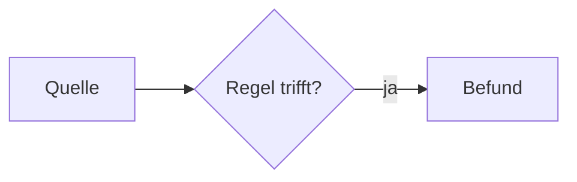

# Was der Scanner tut

Er liest Quelldateien und prueft Regeln. Metriken wie McCabe und cloc
zaehlen dabei mit.

Zwei Absaetze, damit die Trennung sichtbar wird.

| Tabelle | bleibt |
|---|---|
| als | Text |

---

# Zweite Folie

Nur Text, kein Diagramm.
